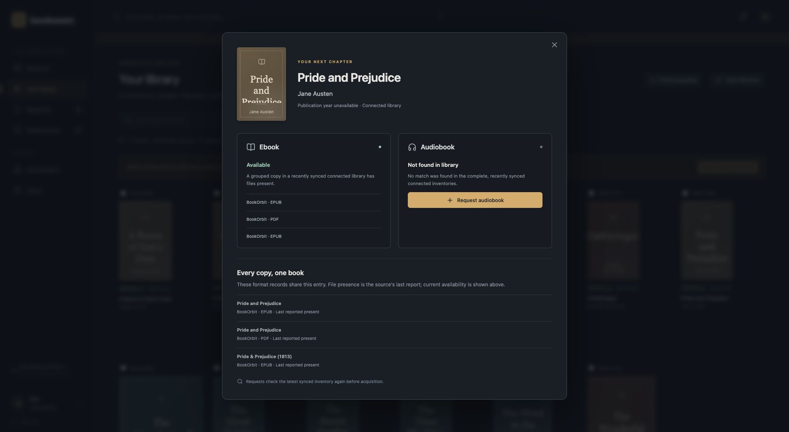

# Bookseerr

[](https://github.com/TeamCogs/bookseerr/actions/workflows/ci.yml)

**Your books. Everyone's next read.**

A self-hosted book discovery and request portal for Docker and NAS deployments. Bring your existing [BookOrbit](https://github.com/bookorbit/bookorbit) library together with official [Chaptarr](https://github.com/Chaptarr/chaptarr), see what you already own, and request the formats you're missing.


## What it does

- **Your whole connected library**, including books acquired outside Bookseerr. Library results appear before online discovery results.
- **Clear ebook and audiobook ownership.** Existing files, monitored records, stale inventories, and uncertain matches are distinguished.
- **One book, every copy.** Duplicates share one entry with all formats and source locations. Review differently named copies, save a preferred title, and undo grouping without deleting files.
- **Multiple readers.** Administrator and reader accounts, approval controls, rolling request limits, shared requests, password management, and personal notifications.
- **Official Chaptarr acquisition.** Separate destination and profile settings for each format, queue tracking, and no required fork.
- **Persistent identity review.** Filename normalization, validated identifiers, and administrator-confirmed matches. Parts and collections aren't automatically treated as the whole book.
- **A small Docker deployment.** One application container and a persistent SQLite volume. No extra database, media mount, or Docker socket.

## Run on your NAS

```sh
git clone https://github.com/TeamCogs/bookseerr.git
cd bookseerr
umask 077
cp .env.example .env
```

Generate **two different** private values with `openssl rand -hex 24` and `openssl rand -hex 32`. Set `BOOKSEERR_ADMIN_PASSWORD` and `BOOKSEERR_SESSION_SECRET` in `.env`, then:

```sh
docker compose up -d
```

Open `http://YOUR-NAS-ADDRESS:5057`, sign in as `admin`, connect your existing services in **Connections**, and create reader accounts in **Users**. If Node.js is installed, `node scripts/setup.mjs` can generate the private environment file for you instead.

Docker Compose is the primary deployment method. The same setup applies to Synology, QNAP, TrueNAS releases with Docker support, Unraid, UGREEN, Portainer, and Linux hosts. The container targets x86-64 and ARM64. Platform-specific instructions, networking, permissions, HTTPS, updates, and backups are in [the deployment guide](docs/deployment.md).

The public image is `ghcr.io/teamcogs/bookseerr:latest`, with x86-64 and ARM64 variants. Use `docker compose up -d --build` to build the checked-out source. Portainer users can use [the standalone stack file](deploy/portainer-compose.yaml), which does not require a local environment file.

## How it fits

Bookseerr handles discovery, ownership, users, approvals, and request tracking. Chaptarr handles indexers, downloads, and imports. BookOrbit supplies your existing inventory and remains the reader. Bookseerr's integration does not edit BookOrbit metadata or library files.

Successful complete inventory snapshots establish availability. A failed or partial sync preserves the previous snapshot and cannot prove a book is absent. Uncertain submissions require review rather than automatic replay. [Read the architecture](docs/architecture.md).

## Status and validation

This is an actively developed independent project. Automated tests cover account boundaries, request safety, matching, grouping, persistence, and upstream HTTP contracts. CI builds and runs the hardened production container on x86-64 and ARM64. A live Docker deployment has verified existing BookOrbit ownership and a public-domain ebook request through official Chaptarr, qBittorrent, automatic import, and BookOrbit inventory. The download used a labelled test source rather than a public tracker search result. See the [live verification record and limits](docs/validation.md), and check the workflow for the revision you deploy.

See [implemented features and verification scope](docs/features.md). Bookseerr does not claim all Seerr features: external notification delivery, SSO, reading sync, ebook conversion, and indexer management are not implemented.



## Development

Use Node.js 24 and the pinned pnpm version through Corepack.

```sh
corepack enable
pnpm install --frozen-lockfile
node scripts/setup.mjs
pnpm dev
```

The development interface is at `http://127.0.0.1:5173`; its API proxy uses port 5057. Run `pnpm check` for type checking, behavioral tests, and a production build. To explore an isolated sample library without touching any services, run `pnpm build` and `pnpm demo`, then visit `http://127.0.0.1:5058`. The demo uses in-memory sample accounts and sends no acquisition requests. Never expose demo mode publicly.

## Maintainer and license

Maintained by [Scott / TeamCogs](https://github.com/TeamCogs). Code contributions are currently owner-only; bug reports and suggestions are welcome. See [CONTRIBUTING.md](CONTRIBUTING.md).

[MIT](LICENSE). Bookseerr is an independent application and is not affiliated with or endorsed by Chaptarr, BookOrbit, or Seerr. Upstream projects and Open Library retain their respective names, licenses, and data policies.
