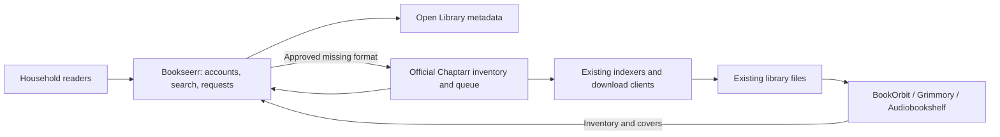

# How Bookseerr works

Bookseerr is a self-hosted discovery, availability, and request portal. Official [Chaptarr](https://github.com/Chaptarr/chaptarr) manages acquisition and imports. One or more [BookOrbit](https://github.com/bookorbit/bookorbit), [Grimmory](https://github.com/grimmory-tools/grimmory), and [Audiobookshelf](https://github.com/advplyr/audiobookshelf) servers supply existing inventory and reader links. Bookseerr is an independent application.



## Accounts and permissions

The first run creates one administrator from the private environment file. Administrators create local reader accounts, choose automatic or manual approval, set a rolling seven-day request limit, disable users, reset passwords, manage connections, review matching decisions, and undo saved duplicate groups. Readers search the same shared library, request missing formats, follow existing requests, see their own followed requests and notifications, and change their password. Joining a shared request does not consume another request allocation. Administrators see all requests. Search exposes the existence of an existing request without exposing its requester or follower list.

Public registration is closed. Users cannot change their own role, quota, approval policy, or connection settings. Administrators cannot demote or disable their own account. Password changes, password resets, permission changes, and account disabling revoke prior sessions. There is no default public password.

## Availability and matching

Ebooks and audiobooks are independent. A monitored Chaptarr record is not a file. BookOrbit records marked missing and Audiobookshelf records marked missing or invalid are not available copies. Grimmory physical books and supplementary files are excluded; its library paths must report healthy before and after the read. A full recent inventory must support a negative ownership result before Bookseerr sends an acquisition request.

Chaptarr may create an author's unmonitored catalogue during a single-book add. Bookseerr reads the complete response but excludes catalogue-only records with no files and no active monitoring. Existing files remain included even if their Chaptarr monitoring is disabled. Actively tracked books without files remain visible with unavailable format badges.

Matching checks normalized title and author, validated ISBNs, and provider work identities. Filename prefixes such as `Author, First - Series 03 - Title.epub` are normalized for display and matching. Parts, volumes, and collections are kept distinct. Related or conflicting metadata requires an administrator's persistent identity decision. Confirming identity does not invent a missing file. Dismissing a possible match applies only to the reviewed item, not future copies.

Each named server commits its inventory as one SQLite transaction after the whole read has been validated. Repeated IDs, changing totals, missing pages, inaccessible selected libraries, malformed responses, and authentication failures retain that server's previous snapshot. Other servers can still sync successfully. A fresh matching copy from any connected server establishes availability; a negative result requires every configured source to be fresh. A newly added connection with incomplete credentials also blocks negative results until fixed or removed. Previously seen copies remain visible with unverified availability. Startup requires a fresh source check before trusting a previous snapshot. A saved snapshot remains unverified while a startup check, changed connection, or retry after a failed read is in progress. A normal background sync can retain a still-fresh, previously verified snapshot.

BookOrbit and Audiobookshelf use zero-based pages of 100 records. Audiobookshelf requests full item details without series collapsing and excludes podcast libraries. Grimmory reads the complete `/api/v1/libraries/{id}/book` list for each selected library, including primary and alternate file formats; the standard 32 MiB response limit still applies. Chaptarr's general book endpoint explicitly includes authors. These details are covered by adapter contract tests.

Each connection has a stable ID separate from its provider type. Source keys, copy IDs, covers, freshness, and credentials are scoped to that connection, so two servers can report the same remote book ID without overwriting each other. Library cards retain connection names and reader links. Existing `BOOKORBIT_*` or encrypted single-BookOrbit settings normalize into the reserved `bookorbit` connection without changing inventory IDs, saved groups, or reviewed matches. Saved connection arrays become authoritative. Removing a connection forgets only its local cache and health state; it does not change upstream books. A delayed response from an old configuration cannot replace a new connection's snapshot.

## Duplicate grouping

Matching titles and authors share one library card across formats and sources. Compatible records with the same provider work identity also share one card when subtitles or expanded author names differ. Unknown authors and conflicting identities are not automatically merged. Each card retains all underlying format records and source links. Parts, volumes, and collections stay separate. Administrators can select differently named entries, confirm that they represent the same complete work, choose a preferred title, and save a group. Saved groups persist and can be undone. Grouping never deletes files or changes upstream metadata.

## Request lifecycle

```text
requested by a reader -> pending approval -> approved / waiting for setup
                     -> submitting -> requested -> downloading -> importing -> available
                     -> declined or cancelled before acquisition
                     -> needs review if identity, network outcome, or import is uncertain
```

A unique database constraint coalesces concurrent requests for the same catalogue work and medium. Approved requests are processed in the background with a visible inventory-checking state. Every connected server's complete inventory is refreshed before acquisition, then every remote write checks availability again. The browser can leave the page while verification proceeds. Cancellation during checking prevents submission. Chaptarr lookup must resolve a unique compatible work. Existing local instances are reused. Only the requested medium is submitted, with separate destination and profile settings. New authors do not automatically monitor their entire catalogue.

Requests made from a connected-library card and an online result with the same complete normalized title and author, or a compatible resolved work identity, join the same format request. This identity check runs inside the database transaction, before applying a new-request quota. Both views show the same request and following state. Incomplete identities, parts, volumes, and different authors remain separate. Chaptarr's validated canonical work aliases persist in Bookseerr's catalogue through later discovery refreshes so an imported edition can fulfill the original request despite a subtitle difference.

An empty metadata lookup is retried with persistent backoff before any add is attempted. Six unsuccessful retries eventually require review. A Chaptarr `202` response with a valid pending-operation ID is saved and followed through read-only lookups for up to six hours. Once its local instance exists, Bookseerr reuses it and sends the format's search command without repeating the add. An HTTP timeout during submission, unexpected response, unresolved pending operation, or restart during an uncertain write moves the request to review. An administrator must check Chaptarr before reopening it. Cancellation remains available during metadata and inventory checks; active acquisition is managed in Chaptarr. Readers can stop following a shared request without cancelling it for others. A previously fulfilled request can acquire the format again if a fresh complete inventory confirms its files are now missing; each new acquisition still counts toward the requester's limit.

## Runtime and data

The production container serves the React interface and Fastify API from one origin and stores SQLite in `/data`. No Redis, external database, Docker socket, media mount, or privileged container is required. One instance should own one data volume. Do not run replicas against the same SQLite database. Place the database volume on local storage with reliable locking, not an SMB or NFS mount.

Passwords use salted scrypt hashes. Session cookies are opaque and HTTP-only; session tokens are hashed in the database. Writes require CSRF tokens and same-origin checks. Connection credentials saved in the interface use authenticated encryption with the private installation key. Request logging omits credentials and search contents. Cover access is authenticated and bounded. Only administrators can configure upstream service URLs.

Search queries and discovery keywords, topics, languages, and publication filters go to Open Library. The default discovery page reads its weekly community chart; its cache and upstream pacing are shared across readers. Discovery ranking never uses user history or local inventory. Availability is attached locally after the provider list is fetched. Inventory and authenticated cover requests go to their configured library server. Passwords and Audiobookshelf API tokens are encrypted in settings and omitted from settings readback; tokens are sent in authorization headers, never reader links. A blank credential reuses a saved secret only for the same server type, internal URL, and username. Chaptarr receives work identifiers and approved acquisition requests. Bookseerr does not run downloads or change your download clients' routing. Configure VPN isolation and import paths in the acquisition stack itself.
